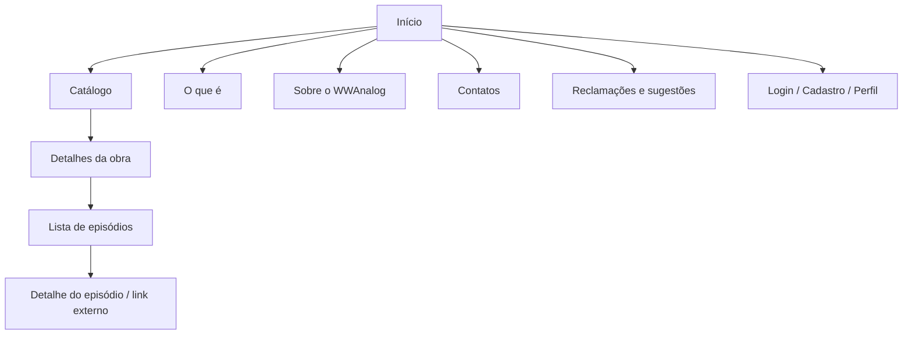
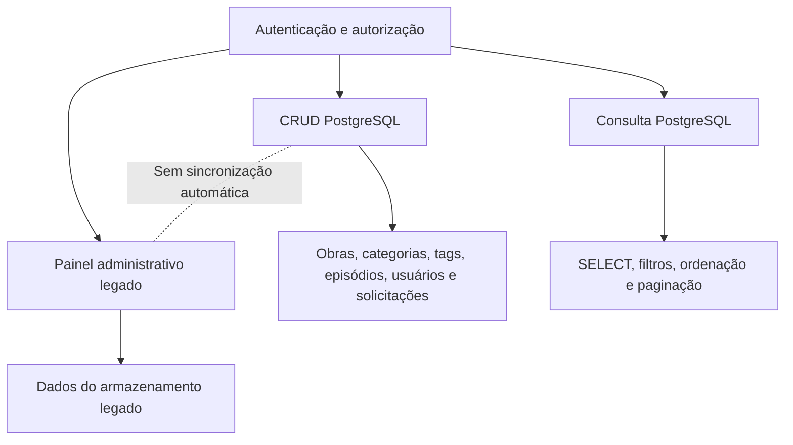
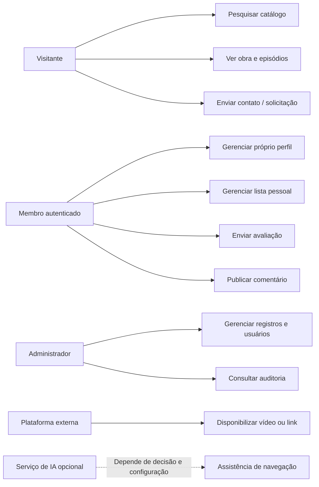
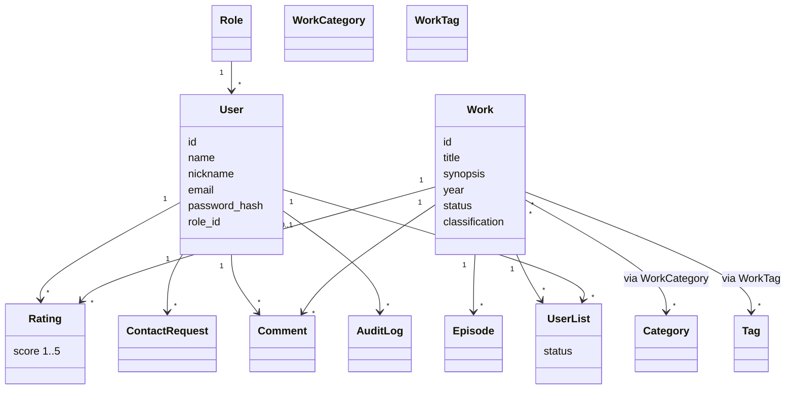

# WWAnalog — Wiki Watch Analog

> **Documentação completa do projeto**
>
> **Versão documental:** 1.9 — revisão proposta  
> **Data de atualização:** 21/10/2026  
> **Responsável indicada no documento-base:** Alicia Flor  
> **Status:** Em andamento  
> **Público-alvo:** Equipe de desenvolvimento

---

## Sumário

1. [Sobre o projeto](#1-sobre-o-projeto)
2. [Introdução e escopo](#2-introdução-e-escopo)
3. [Planejamento inicial](#3-planejamento-inicial)
4. [Requisitos funcionais](#4-requisitos-funcionais)
5. [Requisitos não funcionais](#5-requisitos-não-funcionais)
6. [Regras de negócio](#6-regras-de-negócio)
7. [Arquitetura e estrutura](#7-arquitetura-e-estrutura)
8. [Banco de dados PostgreSQL](#8-banco-de-dados-postgresql)
9. [Catálogo inicial de obras](#9-catálogo-inicial-de-obras)
10. [Páginas e módulos](#10-páginas-e-módulos)
11. [Segurança e boas práticas](#11-segurança-e-boas-práticas)
12. [Área administrativa](#12-área-administrativa)
13. [Instalação e execução](#13-instalação-e-execução)
14. [Composer e integração de IA](#14-composer-e-integração-de-ia)
15. [Diagramas](#15-diagramas)
16. [Testes e validação](#16-testes-e-validação)
17. [Limitações e melhorias futuras](#17-limitações-e-melhorias-futuras)
18. [Referência dos arquivos](#18-referência-dos-arquivos)
19. [Histórico de revisões](#19-histórico-de-revisões)

---

# 1. Sobre o projeto

## 1.1 Identificação

**WWAnalog — Wiki Watch Analog** é uma aplicação web independente destinada à catalogação, organização e consulta de obras do gênero Analog Horror.

A plataforma busca centralizar informações que normalmente estão distribuídas entre diferentes sites e canais, facilitando a descoberta de obras, a consulta de episódios e o acesso às fontes originais.

A aplicação utiliza uma identidade visual inspirada em fitas VHS, televisores CRT, transmissões antigas e elementos de horror analógico.

## 1.2 Objetivos

- Organizar obras de Analog Horror em um catálogo pesquisável.
- Apresentar sinopses, criadores, categorias, tags, classificações e episódios quando essas informações estiverem disponíveis.
- Facilitar o acesso aos vídeos e canais originais.
- Permitir que usuários autenticados mantenham listas pessoais.
- Disponibilizar avaliações e comentários conforme os recursos implementados.
- Oferecer páginas para contato, reclamações, correções e sugestões.
- Disponibilizar uma área administrativa para gerenciamento de dados e usuários autorizados.
- Manter uma arquitetura segura, organizada e passível de manutenção.

## 1.3 Estado da documentação

Esta documentação diferencia três situações:

- **Implementado:** funcionalidade identificada no código analisado.
- **Pendente:** funcionalidade planejada que ainda precisa ser implementada, integrada ou testada.
- **Recomendação:** melhoria técnica sugerida para a evolução do projeto.

A presença de um requisito nesta documentação não comprova que ele já esteja funcionando. A análise técnica registrada é documental e estática; os procedimentos precisam ser validados no ambiente real.

## 1.4 Definições e abreviações

| Termo | Significado |
|---|---|
| Analog Horror | Gênero de terror que utiliza recursos visuais e sonoros associados a mídias analógicas, transmissões antigas e gravações encontradas. |
| Back-end | Parte responsável pelas regras da aplicação, processamento de requisições e comunicação com o banco. |
| Front-end | Parte da aplicação com a qual o usuário interage pelo navegador. |
| CRUD | Create, Read, Update, Delete: criar, consultar, atualizar e excluir registros. |
| CSS | Linguagem utilizada para estilizar páginas web. |
| HTML | Linguagem de marcação usada para estruturar páginas web. |
| JavaScript | Linguagem utilizada para implementar interações no navegador. |
| PHP | Linguagem utilizada no processamento do lado do servidor. |
| PostgreSQL | Sistema gerenciador de banco de dados relacional. |
| PDO | Interface do PHP para acesso a bancos de dados. |
| MVP | Minimum Viable Product, ou Produto Mínimo Viável. |
| SGBD | Sistema de Gerenciamento de Banco de Dados. |
| Sessão | Mecanismo para manter o estado de autenticação durante a navegação. |
| XSS | Cross-Site Scripting: vulnerabilidade que pode permitir a execução de scripts maliciosos. |
| CSRF | Cross-Site Request Forgery: ataque que tenta induzir um navegador autenticado a enviar requisições indesejadas. |
| SQL Injection | Vulnerabilidade em que entradas são interpretadas indevidamente como comandos SQL. |
| Composer | Gerenciador de dependências do PHP. |

---

# 2. Introdução e escopo

## 2.1 Propósito

O WWAnalog é uma aplicação web voltada a pessoas interessadas em Analog Horror. O projeto contempla o catálogo de obras, informações detalhadas, acesso a episódios e recursos complementares de conta e administração.

O desenvolvimento utiliza PHP e PostgreSQL como tecnologias principais de back-end e persistência, com HTML, CSS e JavaScript para a interface.

## 2.2 Escopo do sistema

O sistema tem como foco:

1. Catálogo e pesquisa de obras.
2. Páginas individuais das obras.
3. Listas e páginas de episódios.
4. Reprodução por incorporação ou links de plataformas externas.
5. Cadastro, login e perfil.
6. Listas pessoais de acompanhamento.
7. Avaliações e comentários.
8. Contatos, reclamações e sugestões.
9. Administração de obras, categorias, tags, episódios, usuários e solicitações.
10. Auditoria de ações administrativas.

Os recursos serão disponibilizados de acordo com a implementação e as prioridades do MVP.

## 2.3 Funcionalidades previstas

### Catálogo

- Exibição de obras em cards.
- Imagem de capa, quando disponível.
- Título, categoria, tags e sinopse.
- Ano, classificação, estado e quantidade de episódios quando confirmados.
- Pesquisa por título.
- Filtros por categoria ou tag, ano e situação.
- Ordenação alfabética.
- Ordenação por popularidade ou atualização somente quando houver dados reais suficientes.

### Episódios

- Listagem de episódios por obra.
- Número ou ordem, título, duração e descrição quando conhecidos.
- Link para o vídeo original.
- Incorporação de vídeo quando permitida pela plataforma de origem.
- Navegação entre a obra e seus episódios.

### Contas e autenticação

- Cadastro com nome, e-mail, apelido e senha.
- Login com e-mail e senha.
- Validação de dados.
- Sessão autenticada.
- Logout.
- Controle de acesso conforme o papel do usuário.

A recuperação de senha foi retirada do escopo atual e não deve ser apresentada como recurso disponível.

### Perfil e listas pessoais

- Foto ou avatar.
- Nome, apelido e descrição.
- Obras adicionadas à lista pessoal.
- Estados de acompanhamento: `Minha lista`, `Assistindo` e `Assistido`.
- Alteração apenas dos dados vinculados à própria conta, respeitando as permissões.

### Avaliações e comentários

- Avaliações de uma a cinco estrelas por obra.
- No máximo uma avaliação ativa por usuário e obra.
- Publicação de comentários por membros autenticados.
- Edição e exclusão dos próprios comentários.
- Moderação administrativa quando implementada.

### Contatos e solicitações

Tipos de solicitação previstos:

- Correção de informação.
- Atualização de conteúdo.
- Pedido de remoção.
- Reclamação.
- Sugestão.
- Outro contato.

O sistema deve confirmar o recebimento apenas depois que a operação for concluída com sucesso.

### Fora do escopo atual

- Hospedagem própria dos vídeos originais.
- Produção ou distribuição de obras audiovisuais.
- Aplicativos nativos para Android ou iOS.
- Pagamentos, assinaturas ou doações.
- Monetização por anúncios.
- Sistema avançado de recomendação por IA.
- Assistente de IA como recurso garantido do MVP.
- Recuperação de senha.
- Fórum de teorias.
- Integrações externas não aprovadas como necessárias.

O Fórum existiu em versões anteriores do planejamento, mas foi retirado do escopo vigente. Não deve ser tratado como módulo atual.

## 2.4 Público-alvo

O público-alvo é composto por pessoas interessadas em Analog Horror que desejam descobrir obras, consultar informações, acessar episódios e acompanhar conteúdos.

A referência inicial do projeto considera público a partir de 14 anos. Essa indicação não substitui a classificação indicativa específica de cada obra nem as exigências legais aplicáveis.

## 2.5 Classes de acesso

### Visitante

Pessoa que acessa o site sem autenticação.

Pode consultar as páginas públicas e o catálogo. Não possui listas pessoais vinculadas a uma conta e não deve executar ações que exijam autenticação.

**Visitante não é um papel armazenado no banco de dados.**

### Membro

Usuário com conta autenticada.

Pode utilizar os recursos públicos, atualizar o próprio perfil e acessar as funcionalidades pessoais habilitadas, como listas, comentários e avaliações.

Não pode executar operações administrativas nem modificar dados de outros usuários sem autorização.

### Administrador

Usuário autorizado a gerenciar a plataforma.

As permissões administrativas podem incluir gerenciamento de obras, categorias, tags, episódios, usuários, comentários, solicitações e consulta aos registros de auditoria.

A autorização deve ser validada no servidor.

**Os únicos papéis persistidos definidos para o projeto são `Membro` e `Administrador`.** Papéis adicionais não devem ser considerados parte do modelo atual sem uma nova decisão.

## 2.6 Ambiente operacional

- Interface: HTML, CSS e JavaScript.
- Back-end: PHP.
- Banco de dados: PostgreSQL.
- Acesso ao banco: PDO.
- Vídeos: plataformas externas, como YouTube, quando disponíveis e permitidas.
- Editor: Visual Studio Code ou equivalente.
- Ambiente local: servidor web, PHP e PostgreSQL.
- Sistema operacional: Windows, Linux ou outro compatível.

As versões específicas das ferramentas devem ser confirmadas no ambiente real.

## 2.7 Restrições e dependências

O projeto está condicionado ao prazo de desenvolvimento, à disponibilidade de recursos, à infraestrutura e às prioridades do MVP.

A reprodução de vídeos depende da disponibilidade dos serviços externos e das permissões de incorporação. A disponibilização de imagens e informações deve respeitar direitos autorais, termos de uso e legislação aplicável.

A manutenção após a entrega dependerá da disponibilidade da equipe responsável.

---

# 3. Planejamento inicial

## 3.1 Entregáveis

### Documentação

- Identificação e histórico de revisões.
- Objetivos, escopo e requisitos.
- Funcionalidades e classes de acesso.
- Regras de negócio e critérios de aceitação.
- Arquitetura e banco de dados.
- Instruções de instalação, configuração e execução.

### Interface

- Página inicial.
- Catálogo.
- Detalhes das obras.
- Lista e páginas de episódios.
- Cadastro, login e perfil.
- Contatos e solicitações.
- Área administrativa.
- Identidade visual responsiva.

### Aplicação

- Consulta e organização de obras.
- Acesso a vídeos externos.
- Autenticação e gerenciamento de contas.
- Listas pessoais, avaliações e comentários conforme o estado da implementação.
- Operações administrativas autorizadas.

### Banco de dados

- Modelagem de entidades e relacionamentos.
- Implementação das tabelas.
- Configuração da conexão.
- Dados iniciais.
- Procedimentos de backup e restauração.

## 3.2 Recursos necessários

- Computador compatível com as ferramentas.
- Editor de código.
- PHP e servidor web.
- PostgreSQL.
- Navegador para testes.
- Ferramentas de modelagem e documentação.
- Git, caso adotado.
- Acesso à internet.
- Informações públicas e links das obras cadastradas.

## 3.3 Cronograma

| Etapa | Descrição | Prazo | Situação documental |
|---|---|---|---|
| 1. Iniciação | Definição inicial e organização das atividades | 24/09/2026 | Concluído |
| 2. Levantamento | Preparação e organização da entrevista | 24–26/09/2026 | Concluído |
| 3. Pesquisa documental | Pesquisa de estruturas de documentação | 26–27/09/2026 | Concluído |
| 4. Estruturação | Organização da documentação | 26–29/09/2026 | Concluído |
| 5. Análise do projeto | Revisão de problemas e funcionalidades | 29/09/2026 | Concluído |
| 6. Prototipagem | Desenho das telas | 29/09–01/10/2026 | Concluído conforme histórico |
| 7. Especificação dos módulos | Organização de cadastro, login, perfil e painel | 01/10/2026 | Concluído conforme histórico |
| 8. Documentação dos requisitos | Escopo, regras e critérios de aceitação | A definir | Em andamento |
| 9. Arquitetura | Pastas, diagramas e banco de dados | A definir | Pendente de confirmação |
| 10. MVP | Catálogo, obras e fluxo de episódios | A definir | A confirmar |
| 11. Implementação complementar | Autenticação, listas, avaliações e administração | A definir | A confirmar |
| 12. Testes | Validação e correção de erros | A definir | A confirmar |
| 13. Preparação da entrega | Ambiente e documentação | A definir | Pendente |
| 14. Entrega final | Demonstração e apresentação | A definir | Pendente |

O planejamento inicial menciona um prazo de duas semanas e um dia, mas a data de entrega de 15/09 é anterior ao início das atividades documentadas em 24/09/2026. A data final precisa ser confirmada.

---

# 4. Requisitos funcionais

Os requisitos abaixo representam o comportamento esperado. Cada item deve ser validado por testes antes de ser considerado concluído.

## 4.1 Cabeçalho e navegação

- **RF-01:** Exibir cabeçalho padronizado com a identificação do WWAnalog.
- **RF-02:** Disponibilizar pesquisa por título quando aplicável.
- **RF-03:** Mostrar login/cadastro a visitantes e acesso ao perfil a usuários autenticados.
- **RF-04:** Permitir navegação entre início, catálogo, obras e episódios.
- **RF-05:** Oferecer caminhos de retorno entre catálogo, obra e episódios.

## 4.2 Página inicial e autenticação

- **RF-06:** Apresentar cards com capa, título e sinopse breve.
- **RF-07:** Destacar obras populares ou atualizadas apenas quando houver dados suficientes.
- **RF-08:** Permitir pesquisa por título na página inicial.
- **RF-09:** Permitir cadastro com nome completo, e-mail, nome de usuário, senha e confirmação.
- **RF-10:** Validar campos obrigatórios, formato do e-mail e confirmação da senha.
- **RF-11:** Impedir duplicidade de e-mail e nome de usuário.
- **RF-12:** Permitir autenticação com e-mail e senha.
- **RF-13:** Negar credenciais inválidas sem revelar se o e-mail está cadastrado.
- **RF-14:** Manter a autenticação por sessão.
- **RF-15:** Permitir logout.
- **RF-16:** Oferecer navegação entre login e cadastro.

## 4.3 Catálogo, obras e episódios

- **RF-17:** Exibir cards com informações disponíveis da obra.
- **RF-18:** Pesquisar obras por título.
- **RF-19:** Filtrar por tags, ano e situação.
- **RF-20:** Ordenar alfabeticamente e por critérios adicionais quando houver dados confiáveis.
- **RF-21:** Apresentar página individual com informações detalhadas.
- **RF-22:** Associar avaliações e comentários às obras.
- **RF-23:** Listar episódios por ordem cadastrada.
- **RF-24:** Apresentar página individual do episódio.
- **RF-25:** Incorporar vídeos externos quando permitido.
- **RF-26:** Disponibilizar links para canais e vídeos originais quando cadastrados.
- **RF-27:** Exibir classificação indicativa e avisos de conteúdo cadastrados.
- **RF-28:** Apresentar mensagem adequada quando não houver resultados.

## 4.4 Usuários

- **RF-29:** Permitir consulta e atualização dos dados permitidos do próprio perfil.
- **RF-30:** Permitir adicionar obras e episódios à lista pessoal, conforme a implementação.
- **RF-31:** Permitir atualizar estados de acompanhamento.
- **RF-32:** Exibir áreas como “Continuar assistindo” e “Minha lista” quando implementadas.
- **RF-33:** Permitir comentários por membros autenticados.
- **RF-34:** Permitir avaliações de uma a cinco estrelas, limitadas a uma avaliação ativa por usuário e obra.
- **RF-35:** Permitir editar e excluir comentários próprios.
- **RF-36:** Impedir alteração de comentários de terceiros sem permissão.
- **RF-37:** Exigir autenticação nas operações restritas.

## 4.5 Contatos e solicitações

- **RF-38:** Disponibilizar formulário para correção, atualização, remoção e sugestões.
- **RF-39:** Confirmar o recebimento somente após sucesso.
- **RF-40:** Disponibilizar canais oficiais de contato.
- **RF-41:** Exibir links comunitários somente quando ativos e autorizados.
- **RF-42:** Apresentar orientações sobre direitos autorais e solicitações de criadores.

## 4.6 Administração e moderação

- **RF-43:** Permitir consultar conteúdos sinalizados ou encaminhados para análise.
- **RF-44:** Permitir ocultar ou remover conteúdos conforme as permissões administrativas.
- **RF-45:** Permitir acompanhar solicitações recebidas.
- **RF-46:** Registrar ações de moderação quando a auditoria estiver integrada.
- **RF-47:** Permitir cadastrar, editar e excluir obras e episódios.
- **RF-48:** Permitir atualizar sinopses, classificações, tags e informações técnicas.
- **RF-49:** Permitir consultar contas e gerenciar permissões autorizadas.
- **RF-50:** Permitir gerenciar comentários e avaliações conforme as regras do sistema.
- **RF-51:** Permitir gerenciar solicitações de contato.
- **RF-52:** Registrar ações administrativas relevantes.
- **RF-53:** Impedir a exclusão de registros de auditoria por operações administrativas comuns.

## 4.7 Indicadores administrativos

- **RF-54:** Apresentar indicadores calculados a partir de registros reais.
- **RF-55:** Exibir ações registradas, como logins, visualizações e comentários, quando coletados.
- **RF-56:** Calcular usuários ativos conforme uma definição e período estabelecidos.
- **RF-57:** Exibir informações de comentários.
- **RF-58:** Apresentar obras com mais e menos visualizações ou comentários quando houver dados.
- **RF-59:** Exibir comentários sinalizados, removidos ou pendentes quando esses estados forem registrados.
- **RF-60:** Exibir gráficos de evolução e distribuição quando implementados.
- **RF-61:** Permitir selecionar período de consulta.
- **RF-62:** Não apresentar estimativas como se fossem dados reais.

---

# 5. Requisitos não funcionais

## 5.1 Ambiente e arquitetura

- **RNF-01:** A aplicação deve funcionar em navegadores modernos e dispositivos móveis.
- **RNF-02:** O back-end deve utilizar PHP.
- **RNF-03:** O front-end deve utilizar HTML, CSS e JavaScript.
- **RNF-04:** A persistência principal deve utilizar PostgreSQL.
- **RNF-05:** Os vídeos devem ser fornecidos por plataformas externas na versão inicial.
- **RNF-06:** A arquitetura deve separar recursos estáticos, componentes compartilhados, páginas públicas e administração.
- **RNF-07:** Devem ser priorizadas tecnologias gratuitas ou de baixo custo.

## 5.2 Segurança e integridade

- **RNF-08:** Armazenar senhas com `password_hash()` e verificá-las com `password_verify()`.
- **RNF-09:** Utilizar consultas preparadas para evitar SQL Injection.
- **RNF-10:** Escapar conteúdo textual antes de exibi-lo, reduzindo riscos de XSS.
- **RNF-11:** Utilizar tokens CSRF nas operações que alteram dados, quando aplicável.
- **RNF-12:** Validar autenticação e autorização no servidor.
- **RNF-13:** Regenerar o identificador da sessão após o login e invalidá-lo no logout.
- **RNF-14:** Utilizar HTTPS em produção e configurar cookies com `Secure`, `HttpOnly` e `SameSite`.
- **RNF-15:** Validar campos obrigatórios, formatos, limites e tipos de dados.
- **RNF-16:** Proteger registros de auditoria contra alterações não autorizadas.
- **RNF-17:** Manter credenciais e informações sensíveis fora dos arquivos públicos.

## 5.3 Usabilidade

- **RNF-18:** Manter interface organizada e coerente com a estética Analog Horror.
- **RNF-19:** Preservar contraste e legibilidade no tema escuro.
- **RNF-20:** Garantir responsividade.
- **RNF-21:** Apresentar mensagens de erro claras sem expor informações confidenciais.
- **RNF-22:** Solicitar confirmação antes de exclusões relevantes.
- **RNF-23:** Confirmar operações somente após sua efetivação.
- **RNF-24:** Tratar falhas de serviços externos de maneira clara.

## 5.4 Desempenho

- **RNF-25:** As páginas devem carregar em tempo adequado ao ambiente.
- **RNF-26:** Pesquisa, filtros e ordenação devem apresentar desempenho adequado ao volume esperado.
- **RNF-27:** A aplicação deve manter estabilidade sob a utilização esperada no contexto do projeto.

## 5.5 Manutenibilidade

- **RNF-28:** Seguir padrões PSR para PHP quando aplicáveis.
- **RNF-29:** Documentar regras de negócio e decisões técnicas relevantes.
- **RNF-30:** Utilizar mensagens de commit claras e padronizadas caso o Git seja adotado.
- **RNF-31:** Considerar versionamento semântico MAJOR.MINOR.PATCH.
- **RNF-32:** Definir procedimentos de backup e restauração.
- **RNF-33:** Preservar integridade referencial no banco.
- **RNF-34:** Manter a documentação atualizada.

## 5.6 Portabilidade e confiabilidade

- **RNF-35:** Funcionar em navegadores compatíveis e atualizados.
- **RNF-36:** Permitir desenvolvimento em sistemas operacionais compatíveis.
- **RNF-37:** Permitir configurar ambiente local com PHP, servidor web e PostgreSQL.
- **RNF-38:** Não apresentar como disponível uma funcionalidade que não esteja implementada.
- **RNF-39:** Respeitar direitos autorais e termos dos serviços externos.
- **RNF-40:** Exibir classificações e avisos de conteúdo conforme os dados disponíveis.

---

# 6. Regras de negócio

1. Uma conta deve possuir e-mail e nome de usuário únicos.
2. Senhas nunca devem ser armazenadas em texto puro.
3. Visitantes podem acessar apenas os recursos públicos.
4. Membros só podem modificar os dados que lhes pertencem, salvo permissões específicas.
5. Apenas administradores autorizados podem executar operações administrativas.
6. O controle de acesso deve ser aplicado no servidor, não apenas na interface.
7. Cada avaliação deve possuir nota entre 1 e 5.
8. Cada usuário pode manter no máximo uma avaliação ativa por obra.
9. Membros podem editar ou excluir os próprios comentários.
10. Comentários de terceiros só podem ser moderados por pessoas autorizadas.
11. Uma obra pode possuir várias tags e categorias conforme o modelo relacional.
12. Cada episódio deve estar associado à obra correspondente.
13. Informações não confirmadas sobre obras e episódios devem permanecer vazias.
14. Os estados de acompanhamento previstos são `Minha lista`, `Assistindo` e `Assistido`.
15. Links externos devem ser apresentados apenas quando cadastrados e válidos.
16. Avisos de conteúdo devem refletir informações conhecidas sobre cada obra.
17. Solicitações de contato devem possuir tipo, mensagem e estado de processamento.
18. Ações administrativas relevantes devem ser registradas em auditoria.
19. Os registros de auditoria não devem possuir exclusão administrativa comum.
20. Indicadores devem ser calculados com base em dados reais.
21. O Fórum está fora do escopo vigente.
22. A recuperação de senha está fora do escopo atual.
23. A autenticação deve utilizar PostgreSQL após a conclusão da migração.
24. PostgreSQL deve ser a origem dos registros de auditoria após a integração de `audit_logs`.

---

# 7. Arquitetura e estrutura

## 7.1 Arquitetura observada

A análise dos arquivos identificou dois caminhos de armazenamento:

### Armazenamento legado

- Arquivo: `database/data.php`.
- Funções: `data_read()` e `data_write()`.
- Definidas ou utilizadas em `includes/functions.php`.
- Utilizado por páginas públicas e por parte dos fluxos legados de conta e administração.

### PostgreSQL

- Conexão PDO inicializada em `includes/config.php`.
- Arquivo de exemplo: `database/config.local.example.php`.
- Módulos administrativos: `people/admin/crud.php` e `people/admin/postgres.php`.
- Tabelas definidas em `dump.sql`.

**Não há sincronização automática comprovada entre os dois armazenamentos.** Alterações feitas em um deles não devem ser presumidas como refletidas no outro.

O cadastro e o login legados utilizam o armazenamento em arquivo. Portanto, inserir uma conta diretamente na tabela `users` não garante que essa conta funcione no login legado.

A decisão de projeto é migrar a autenticação para PostgreSQL e utilizar a tabela PostgreSQL `audit_logs` para auditoria. Essas decisões precisam ser implementadas e testadas.

## 7.2 Estrutura de pastas

A estrutura real deve ser confirmada no repositório. A organização conceitual recomendada é:

```text
wwanalog/
├── assets/
│   ├── css/
│   ├── js/
│   └── images/
├── includes/
│   ├── config.php
│   ├── functions.php
│   └── componentes compartilhados
├── database/
│   ├── data.php
│   ├── config.local.example.php
│   ├── config.local.php
│   └── dump.sql
├── people/
│   └── admin/
│       ├── crud.php
│       ├── postgres.php
│       └── index.php
├── login/
├── contatos/
├── config/
├── knowledge/
├── docs/
│   ├── DIAGRAMAS.md
│   └── FLUXO_DE_TELAS.md
├── index.php
├── catalogo.php
├── obra.php
├── episodio.php
└── README.md
```

Essa árvore é uma referência de organização e não uma afirmação de que todos os diretórios ou arquivos existem exatamente nesses caminhos.

## 7.3 Identidade visual

A interface deve seguir a estética Analog Horror, VHS e CRT.

### Paleta e efeitos

- Fundo preto ou grafite.
- Detalhes em vermelho escuro.
- Tons de cinza.
- Off-white envelhecido.
- Ruído, scanlines e distorções discretas.

Os efeitos devem ser moderados para não comprometer a leitura, o desempenho, a acessibilidade ou a navegação.

### Responsividade

A aplicação deve funcionar em computadores, tablets e celulares, preservando os elementos de navegação e evitando sobreposição de conteúdo.

## 7.4 Mapa de páginas

| Página | Finalidade | Acesso previsto |
|---|---|---|
| Início | Apresentar a plataforma e os destaques | Público |
| Catálogo | Listar, pesquisar, filtrar e ordenar obras | Público |
| Detalhes da obra | Exibir ficha técnica, sinopse e episódios | Público |
| Lista de episódios | Organizar os episódios de uma obra | Público |
| Página do episódio | Exibir informações e link ou player externo | Público, sujeito à disponibilidade |
| Cadastro | Criar conta de membro | Público |
| Login | Autenticar conta existente | Público |
| Perfil | Exibir perfil e recursos pessoais | Público limitado e membro autenticado |
| Reclamações e sugestões | Receber solicitações | Público |
| Contatos | Exibir canais oficiais | Público |
| Painel administrativo | Gerenciar dados e consultar informações autorizadas | Administrador |

Os caminhos reais devem ser confirmados no código. O Fórum não faz parte do mapa de páginas atual.

---

# 8. Banco de dados PostgreSQL

## 8.1 Tabelas identificadas no `dump.sql`

O esquema analisado possui 13 tabelas:

| Tabela | Finalidade |
|---|---|
| `roles` | Papéis de acesso. |
| `users` | Contas, perfil e hash de senha. |
| `categories` | Categorias das obras. |
| `works` | Metadados das obras. |
| `work_categories` | Relacionamento entre obras e categorias. |
| `tags` | Tags reutilizáveis. |
| `work_tags` | Relacionamento entre obras e tags. |
| `episodes` | Episódios associados às obras. |
| `ratings` | Avaliações dos usuários. |
| `comments` | Comentários associados a usuários e obras. |
| `user_lists` | Estados de acompanhamento por usuário e obra. |
| `contact_requests` | Solicitações de contato, correção, remoção e sugestões. |
| `audit_logs` | Registros de auditoria. |

O dump contém dados iniciais de referência, incluindo papéis, categorias, tags, obras e seus relacionamentos. Os dados iniciais devem ser conferidos com as decisões atuais do projeto.

## 8.2 Relacionamentos conceituais

- Um papel pode estar associado a vários usuários.
- Uma obra pode possuir vários episódios.
- Uma obra pode receber várias avaliações.
- Um usuário pode realizar avaliações em diferentes obras.
- Uma obra pode possuir vários comentários.
- Um usuário pode publicar vários comentários.
- Uma obra pode possuir várias tags.
- Uma tag pode estar associada a várias obras.
- Uma obra pode pertencer a várias categorias.
- Um usuário pode manter listas pessoais para várias obras.
- Um usuário pode enviar solicitações de contato.
- Ações administrativas podem gerar registros de auditoria.

Os nomes e atributos exatos devem ser conferidos no `dump.sql`.

## 8.3 Decisões confirmadas

- Usar PostgreSQL para a autenticação do site após a migração.
- Persistir somente os papéis `Membro` e `Administrador`.
- Tratar visitante como usuário não autenticado, sem papel persistido.
- Usar PostgreSQL `audit_logs` como destino dos registros de auditoria.
- Não presumir sincronização entre PostgreSQL e o armazenamento legado.
- Preservar os dados existentes e realizar backup antes de alterações importantes.

## 8.4 Cuidados com o banco

Antes de importar ou executar scripts:

1. Confirmar o banco de destino.
2. Fazer backup de dados importantes.
3. Conferir o conteúdo do arquivo SQL.
4. Não apagar ou recriar o banco existente sem uma decisão explícita.
5. Executar testes de importação em um banco separado quando possível.
6. Verificar chaves estrangeiras, restrições de unicidade e integridade dos relacionamentos.

---

# 9. Catálogo inicial de obras

As informações abaixo refletem as decisões e correções registradas no projeto. Não preencher ano, criador, duração, URL, imagem ou situação por suposição.

| Obra | Categoria | Tag |
|---|---|---|
| The Monument Mythos | Found Footage | `#FoundFootage` |
| Winter of '83 | Found Footage | `#FoundFootage` |
| Eventide Media Center | Broadcast Hijacks | `#BroadcastHijacks` |
| Channel 7 / Analog Archives | Broadcast Hijacks | `#BroadcastHijacks` |
| Blue Channel (THALASIN) | Broadcast Hijacks | `#BroadcastHijacks` |
| Dusk Broadcast | Broadcast Hijacks | `#BroadcastHijacks` |
| Woodlands National Park | Corporate Training Tapes / PSAs | `#CorporateTrainingTapesPSAs` |
| Lacey's Flash Games | Lost Media | `#LostMedia` |
| Super Mario 64: CLASSIFIED | Jogos e Mídia Interativa Corrompidos | Não informada |
| Chimpy Chippa's | Lost Media | `#LostMedia` |
| Liminal Land | ARG | `#ARG` |
| Mystery Flesh Pit National Park | ARG | `#ARG` |
| VCR Willie | Found Footage | `#FoundFootage` |

### Correções registradas

- **Gilbert Garfield:** removido do catálogo.
- **Blue Channel (THALASIN):** 9 episódios.
- **Super Mario 64: CLASSIFIED:** classificação 12+, 14 episódios e categoria Jogos e Mídia Interativa Corrompidos.
- **Tag de Super Mario 64: CLASSIFIED:** não informada; deixar em branco.
- **Lacey's Flash Games:** aviso de conteúdo fornecido: “violência, sugestões de assassinato, sangue, cadáveres e desmembramento.”

### Categorias disponíveis

1. Found Footage.
2. Broadcast Hijacks.
3. Corporate Training Tapes / PSAs.
4. Lost Media.
5. ARG.
6. Substituição / Doppelgängers.
7. Espaços Liminares.
8. Memória e Nostalgia Corrompidas.
9. EAS Scenarios.
10. Animais e Natureza Corrompidos.
11. Jogos e Mídia Interativa Corrompidos.

Uma obra deve aparecer apenas uma vez no catálogo principal, sob sua categoria principal. Os relacionamentos adicionais devem ser usados apenas quando definidos pela equipe.

---

# 10. Páginas e módulos

## 10.1 Página inicial

Deve apresentar:

- Identidade visual WWAnalog.
- Menu de navegação.
- Pesquisa por título.
- Acesso ao catálogo.
- Destaques editoriais quando houver dados.
- Cards de obras.
- Acesso às páginas institucionais.
- Rodapé com informações e contatos oficiais.

## 10.2 Catálogo

Cada card poderá apresentar:

- Capa, se disponível.
- Título.
- Categoria e tags.
- Sinopse curta.
- Ano, estado, classificação e quantidade de episódios, quando conhecidos.
- Link para os detalhes da obra.

Filtros e ordenação devem utilizar os dados cadastrados. Não apresentar popularidade ou atualização recente sem registros confiáveis.

## 10.3 Detalhes da obra

A página pode apresentar:

- Título.
- Imagem ou banner.
- Sinopse e enredo.
- Categoria e tags.
- Criador ou canal, quando conhecido.
- Ano, estado e classificação, quando disponíveis.
- Avisos de conteúdo.
- Lista de episódios.
- Links externos.
- Avaliações e comentários, quando habilitados.
- Ação para adicionar à lista pessoal, exigindo autenticação.

## 10.4 Episódios

Cada episódio pode possuir:

- Obra associada.
- Número ou ordem.
- Título.
- Descrição.
- Duração e data, quando conhecidas.
- Link externo ou player incorporado.
- Navegação de retorno para a obra e para a lista de episódios.

## 10.5 Cadastro

Campos previstos:

- Nome completo.
- E-mail.
- Nome de usuário.
- Senha.
- Confirmação de senha.

O sistema deve validar os dados antes de criar a conta e impedir e-mails ou nomes de usuário duplicados.

## 10.6 Login

Campos previstos:

- E-mail.
- Senha.

O login deve validar as credenciais, criar uma sessão segura e aplicar o papel de acesso correspondente.

A recuperação de senha não faz parte do escopo atual.

## 10.7 Perfil

Pode apresentar:

- Avatar ou foto.
- Nome.
- Apelido.
- Descrição.
- Listas pessoais.
- Estados de acompanhamento.
- Comentários e avaliações do usuário, conforme a política de exibição.

O usuário deve conseguir editar apenas os dados permitidos de sua própria conta.

## 10.8 Contatos, reclamações e sugestões

A página deve permitir o envio de solicitações de correção, atualização, remoção, reclamações, sugestões e outros contatos.

Os dados pessoais de contato da equipe só devem ser publicados quando autorizados. Links para comunidades devem estar ativos e autorizados para divulgação.

## 10.9 Fórum

O Fórum foi retirado do escopo atual. Menções ao Fórum no histórico existem apenas para registrar a evolução do planejamento; não devem ser interpretadas como requisito vigente.

---

# 11. Segurança e boas práticas

## 11.1 Senhas

Utilizar as funções nativas do PHP:

```php
$hash = password_hash($senha, PASSWORD_DEFAULT);
```

Na autenticação:

```php
if (password_verify($senhaInformada, $hashArmazenado)) {
    // Credenciais válidas.
}
```

Nunca armazenar senhas em texto puro ou registrar senhas em logs.

## 11.2 Consultas SQL

Utilizar consultas preparadas com PDO:

```php
$stmt = $pdo->prepare(
    'SELECT id, email, password_hash FROM users WHERE email = :email'
);

$stmt->execute([
    'email' => $email
]);

$user = $stmt->fetch(PDO::FETCH_ASSOC);
```

O nome real da coluna de hash deve ser confirmado no esquema utilizado.

Nunca concatenar diretamente entradas do usuário em comandos SQL.

## 11.3 Autorização

A verificação de permissões deve acontecer no servidor antes de cada operação restrita.

Ocultar um botão na interface não impede que uma pessoa tente acessar diretamente uma rota ou enviar uma requisição manualmente.

O painel administrativo deve exigir uma sessão válida e o papel `Administrador`.

## 11.4 XSS e validação

- Validar entradas antes de processá-las.
- Limitar tamanhos e tipos de dados.
- Escapar texto antes de exibi-lo em HTML.
- Não confiar em dados enviados pelo navegador.
- Evitar interpretar conteúdo fornecido pelo usuário como HTML ou JavaScript.

Exemplo de escape em PHP:

```php
echo htmlspecialchars(
    $texto,
    ENT_QUOTES,
    'UTF-8'
);
```

## 11.5 CSRF e sessões

- Gerar e validar tokens CSRF em operações que alteram dados.
- Regenerar o identificador da sessão após o login.
- Encerrar e invalidar a sessão no logout.
- Configurar cookies com `Secure`, `HttpOnly` e `SameSite` em ambientes compatíveis.
- Utilizar HTTPS em produção.

## 11.6 Arquivos e segredos

- Não publicar senhas, tokens ou chaves de API.
- Não versionar `database/config.local.php`.
- Manter arquivos de configuração privados fora de áreas públicas sempre que possível.
- Não enviar backups com dados pessoais para repositórios públicos.
- Rotacionar qualquer chave de API que tenha sido exposta.

## 11.7 Direitos autorais e conteúdo

A plataforma deve respeitar os direitos dos criadores. Links, imagens e vídeos precisam seguir as permissões e condições dos serviços de origem.

A incorporação de um vídeo não garante, por si só, que qualquer uso do conteúdo seja permitido.

## 11.8 Boas práticas de desenvolvimento

Quando aplicável:

- Utilizar PSR-12 para estilo PHP.
- Utilizar PSR-4 se o projeto adotar autoload de classes.
- Documentar regras de negócio e decisões técnicas.
- Manter backup e restauração testados.
- Usar commits claros, como `feat:`, `fix:`, `docs:`, `refactor:` e `test:`.
- Considerar versionamento semântico MAJOR.MINOR.PATCH.

---

# 12. Área administrativa

## 12.1 Módulos observados

### `people/admin/crud.php`

Foi identificado como módulo de CRUD PostgreSQL para:

- Obras (`works`).
- Categorias (`categories`).
- Tags (`tags`).
- Episódios (`episodes`).
- Comentários (`comments`).
- Usuários (`users`).
- Solicitações de contato (`contact_requests`).

Não foi identificado CRUD nesse módulo para `ratings`, `user_lists` ou `audit_logs`.

### `people/admin/postgres.php`

Foi identificado como módulo de consulta PostgreSQL, com pesquisa, filtros, ordenação e paginação para:

- `works`
- `users`
- `episodes`
- `categories`
- `tags`
- `comments`
- `ratings`
- `user_lists`
- `contact_requests`
- `audit_logs`

Esse módulo é de consulta e não deve ser descrito como responsável por INSERT, UPDATE ou DELETE.

### Painel legado

`people/admin/index.php` e outras telas administrativas legadas usam o armazenamento em arquivo. Não existe sincronização automática comprovada com os módulos PostgreSQL.

## 12.2 Indicadores

O painel poderá apresentar, quando houver dados reais:

- Total de ações registradas.
- Usuários ativos por período.
- Comentários analisados.
- Obras com mais e menos visualizações.
- Obras com mais e menos comentários.
- Comentários sinalizados, removidos ou pendentes.
- Distribuição de comentários por obra.
- Evolução temporal das atividades.
- Ações administrativas recentes.

Esses indicadores dependem da coleta, persistência e consulta dos eventos correspondentes.

## 12.3 Auditoria

O destino definido para auditoria é a tabela PostgreSQL `audit_logs`.

Na análise realizada, a função `audit_event()` gravava eventos na coleção `audit` do armazenamento legado, não diretamente em `audit_logs`.

É necessário adaptar a função para registrar, no PostgreSQL, informações como:

- Responsável pela ação.
- Operação realizada.
- Entidade afetada.
- Identificador do registro, quando aplicável.
- Data e hora.
- Informações mínimas necessárias para rastreabilidade.

Os registros devem ser protegidos contra alterações não autorizadas e não devem ser removidos por um CRUD administrativo comum.

---

# 13. Instalação e execução

As instruções abaixo são modelos. Os comandos e caminhos precisam ser ajustados ao ambiente real. Faça backup antes de executar alterações em um banco existente.

## 13.1 Requisitos

- PHP compatível com o código.
- Extensão PDO para PostgreSQL (`pdo_pgsql`).
- PostgreSQL.
- Servidor web ou servidor embutido do PHP para desenvolvimento.
- Arquivos do projeto.
- `dump.sql`, se for necessário criar o esquema a partir desse arquivo.

## 13.2 Linux baseado em Debian/Ubuntu

Instalar as dependências comuns:

```bash
sudo apt update
sudo apt install php-cli php-pgsql postgresql postgresql-contrib git -y
```

Conferir as versões e a extensão:

```bash
php -v
php -m | grep -i pgsql
sudo systemctl status postgresql
```

A lista de módulos deve incluir os drivers necessários ao acesso PostgreSQL.

## 13.3 Criar usuário e banco

Abra o console do PostgreSQL:

```bash
sudo -u postgres psql
```

Execute dentro do console:

```sql
CREATE USER wwanalog_user
WITH PASSWORD 'SUBSTITUA_POR_UMA_SENHA_FORTE';

CREATE DATABASE wwanalog
OWNER wwanalog_user
ENCODING 'UTF8';
```

Saia do console:

```sql
\q
```

A senha acima é apenas um exemplo de marcador. Substitua-a por uma senha forte e privada.

Não utilize o superusuário `postgres` como conta comum da aplicação.

## 13.4 Importar o esquema

Para importar um arquivo SQL textual:

```bash
psql -h localhost -U wwanalog_user -d wwanalog -f dump.sql
```

Para listar as tabelas:

```bash
psql -h localhost -U wwanalog_user -d wwanalog -c "\dt"
```

O comando `psql -f` é apropriado para arquivos SQL textuais. `pg_restore` é destinado a formatos de backup compatíveis, como os formatos custom do `pg_dump`.

A importação deve ser realizada somente depois de confirmar o banco de destino. Se o banco já contiver dados, revise o script antes de executá-lo.

## 13.5 Configurar o PHP

Copie o arquivo de exemplo:

```text
database/config.local.example.php
```

para:

```text
database/config.local.php
```

Preencha as configurações de conexão com os valores locais corretos.

O arquivo real deve permanecer privado e não deve ser publicado no repositório.

Verifique se `includes/config.php` inicializa a conexão PDO de acordo com a configuração adotada.

## 13.6 Executar localmente

Na raiz do projeto:

```bash
php -S 127.0.0.1:8000
```

Abra:

```text
http://127.0.0.1:8000
```

O servidor embutido do PHP é destinado a desenvolvimento e testes, não a produção.

Em produção, configure um servidor web apropriado, PHP, HTTPS, permissões de arquivos e logs.

## 13.7 Windows

1. Instale uma versão compatível do PHP e do PostgreSQL.
2. Configure um ambiente web local, como XAMPP ou Laragon, se essa for a opção escolhida.
3. Habilite `pdo_pgsql` no `php.ini`.
4. Reinicie o serviço PHP ou Apache depois da alteração.
5. Crie o banco e o usuário de aplicação pelo `psql` ou pgAdmin.
6. Importe `dump.sql` para o banco correto.
7. Copie `database/config.local.example.php` para `database/config.local.php`.
8. Preencha as configurações locais.
9. Inicie o servidor conforme a estrutura real do projeto.

Exemplo de importação no Windows:

```bash
psql -U wwanalog_user -h localhost -d wwanalog -f dump.sql
```

O comando depende de o executável `psql` estar disponível no PATH ou de seu caminho completo ser informado.

## 13.8 Composer e dependências PHP

O Composer é o gerenciador de dependências do PHP. Ele é útil quando o projeto utiliza bibliotecas externas instaladas por meio de um arquivo `composer.json`.

**Não é obrigatório instalar bibliotecas pelo Composer apenas para editar arquivos PHP.** Se o projeto não utiliza dependências externas, a instalação do Composer pode não ser necessária para executar o código existente.

Para verificar se o Composer está disponível:

```bash
composer --version
```

Se o comando não for reconhecido, instale o Composer seguindo as instruções oficiais para seu sistema operacional:

https://getcomposer.org/download/

Se o projeto já tiver um `composer.json`, entre na pasta que contém esse arquivo e execute:

```bash
composer install
```

Esse comando instala as dependências declaradas no projeto. Ele não deve ser executado como substituto da instalação do PHP, do PostgreSQL ou da extensão `pdo_pgsql`.

Não crie dependências ou execute `composer require` para bibliotecas de IA sem antes confirmar qual integração o código utiliza.

## 13.9 Backup e restauração

Backup em formato custom:

```bash
pg_dump -h localhost -U wwanalog_user -d wwanalog -Fc -f wwanalog_backup.dump
```

Backup em SQL textual:

```bash
pg_dump -h localhost -U wwanalog_user -d wwanalog -f wwanalog_backup.sql
```

Listar o conteúdo de um backup custom:

```bash
pg_restore --list wwanalog_backup.dump
```

Restaurar um SQL textual em um banco de teste:

```bash
psql -h localhost -U wwanalog_user -d wwanalog_teste -f wwanalog_backup.sql
```

Restaurar um backup custom em um banco de teste:

```bash
pg_restore -h localhost -U wwanalog_user -d wwanalog_teste --no-owner wwanalog_backup.dump
```

Os arquivos de backup podem conter dados pessoais e hashes de senha. Restrinja o acesso e teste a restauração em um banco separado antes de depender do procedimento.

## 13.10 Solução de problemas

| Problema | Verificações |
|---|---|
| `could not find driver` | Verificar se `pdo_pgsql` está instalado e habilitado na versão do PHP usada pelo servidor. |
| `connection refused` | Verificar se o PostgreSQL está iniciado, o host e a porta estão corretos e o serviço aceita conexões. |
| `password authentication failed` | Conferir usuário, senha e regras de autenticação. Não registrar credenciais reais nos logs. |
| `relation does not exist` | Confirmar se `dump.sql` foi importado no banco correto e verificar as tabelas com `\dt`. |
| Página em branco ou erro 500 | Consultar os logs do PHP e do servidor. Habilitar detalhes de erro somente em ambiente local. |
| Vídeo não incorpora | Verificar URL, disponibilidade e permissões. Disponibilizar link externo quando necessário. |
| Upload de imagem falha | Verificar diretório, permissões e validação de tipo, extensão e tamanho. |
| Sessão não persiste | Conferir configuração de sessão, cookies, HTTPS e atributos de segurança. |
| Dados não aparecem no catálogo | Verificar se a página consulta o armazenamento legado ou PostgreSQL. |
| Auditoria não aparece em PostgreSQL | A função `audit_event()` precisa ser migrada para registrar os eventos em `audit_logs`. |

---

# 14. Composer e integração de IA

## 14.1 Situação da IA

A IA foi considerada durante o planejamento, mas não deve ser apresentada como uma funcionalidade garantida do MVP.

Antes de implementar ou documentar o assistente como operacional, é necessário confirmar:

- Qual serviço de IA será utilizado.
- Qual API será chamada.
- Qual biblioteca, se houver, será usada no PHP.
- Como a chave de API será configurada.
- Quais limites de uso e custos se aplicam.
- Qual será a finalidade do assistente.
- Se o recurso será mantido fora do MVP ou implementado em uma versão futura.

A existência de arquivos relacionados à IA não comprova que a integração esteja configurada ou funcionando.

## 14.2 Quando instalar bibliotecas

O Composer deve ser usado quando a integração escolhida depender de um pacote PHP distribuído por ele.

O procedimento depende do serviço e da biblioteca confirmados. Não é seguro recomendar um pacote específico sem conferir o código atual e a documentação do fornecedor.

Quando houver um `composer.json` válido:

```bash
composer install
```

Se a integração exigir uma nova dependência, o pacote deverá ser identificado a partir da documentação oficial do serviço e adicionado conscientemente ao projeto. O comando exato dependerá dessa escolha.

## 14.3 Proteção da chave de API

A chave de API deve permanecer no servidor e nunca ser incluída no JavaScript público, no HTML, em mensagens de erro ou no repositório.

Recomendações:

- Utilizar variável de ambiente ou configuração privada no servidor.
- Não armazenar a chave em arquivos públicos.
- Não registrar a chave nos logs.
- Não enviar a chave ao navegador.
- Limitar o acesso e o uso da chave conforme os recursos do fornecedor.
- Rotacionar chaves que tenham sido expostas.
- Documentar apenas o nome da variável de ambiente, nunca o valor real.

Exemplo ilustrativo de acesso a uma variável de ambiente no PHP:

```php
$apiKey = getenv('AI_API_KEY');

if (!$apiKey) {
    throw new RuntimeException(
        'A chave da API de IA não está configurada no servidor.'
    );
}
```

`AI_API_KEY` é apenas um nome de exemplo. O nome final deve corresponder à integração efetivamente escolhida.

## 14.4 Execução e teste da IA

Depois de selecionar e configurar o serviço:

1. Instalar as dependências exigidas pela biblioteca escolhida.
2. Configurar a chave no ambiente privado do servidor.
3. Implementar a chamada de API no back-end.
4. Tratar erros de rede, autenticação, limites e respostas inválidas.
5. Evitar registrar dados pessoais ou segredos em logs.
6. Testar a integração sem expor a chave.
7. Documentar os requisitos de execução específicos do serviço.
8. Manter o recurso desativado ou claramente indisponível até concluir os testes.

A instalação do Composer, isoladamente, não implementa um assistente de IA.

---

# 15. Diagramas

Os diagramas abaixo são representações conceituais em Mermaid. Eles devem ser atualizados conforme a integração real evoluir.

## 15.1 Arquitetura de dados observada

```mermaid
flowchart TD
    Browser[Usuário / navegador] --> PHP[Aplicação PHP]

    PHP --> Legacy[database/data.php]
    PHP --> PDO[Conexão PDO]
    PDO --> PG[(PostgreSQL)]

    Legacy -. Sem sincronização automática confirmada .- PG

    Audit[audit_event()] --> LegacyAudit[Coleção audit no arquivo]
    PG --> AuditTable[(audit_logs)]
```

## 15.2 Fluxo público



## 15.3 Fluxo administrativo



## 15.4 Casos de uso



## 15.5 Diagrama conceitual de entidades



> O diagrama é conceitual. Os nomes e atributos exatos devem ser confirmados em `dump.sql`; ele não substitui o esquema SQL executável.

---

# 16. Testes e validação

Antes da entrega, verificar os seguintes itens.

## 16.1 Navegação e catálogo

- [ ] A página inicial abre sem erros fatais.
- [ ] O catálogo exibe as obras cadastradas.
- [ ] A pesquisa por título funciona.
- [ ] Os filtros retornam resultados coerentes.
- [ ] A ordenação e a paginação funcionam.
- [ ] Os estados vazios são apresentados adequadamente.
- [ ] Os links entre obra e episódios funcionam.
- [ ] Vídeos indisponíveis apresentam uma mensagem ou link alternativo.

## 16.2 Autenticação e permissões

- [ ] O cadastro valida os campos obrigatórios.
- [ ] E-mails e nomes de usuário duplicados são recusados.
- [ ] Senhas são armazenadas com hash seguro.
- [ ] O login verifica as credenciais corretamente.
- [ ] O logout encerra a sessão.
- [ ] O perfil modifica apenas os dados permitidos.
- [ ] Um membro não consegue acessar o painel administrativo manipulando URLs.
- [ ] A autenticação utiliza PostgreSQL após a migração.
- [ ] O papel `Administrador` é verificado no servidor.

## 16.3 Segurança

- [ ] Entradas são validadas no servidor.
- [ ] Consultas utilizam parâmetros preparados.
- [ ] Textos são escapados antes da exibição.
- [ ] Operações de alteração verificam CSRF quando aplicável.
- [ ] Mensagens de erro não expõem credenciais.
- [ ] Arquivos privados não estão publicados no repositório.
- [ ] A chave de API, se houver, permanece no servidor.

## 16.4 PostgreSQL

- [ ] A conexão PDO funciona com as credenciais locais.
- [ ] O dump é importado em um banco de teste sem erros.
- [ ] As tabelas e os relacionamentos estão corretos.
- [ ] O CRUD PostgreSQL cria, edita e exclui registros de teste.
- [ ] Filtros e ordenação usam parâmetros e colunas permitidas.
- [ ] As operações respeitam integridade referencial.
- [ ] O armazenamento legado e o PostgreSQL são testados separadamente enquanto coexistirem.
- [ ] A auditoria grava em `audit_logs` após a migração.
- [ ] Backup e restauração foram testados.

## 16.5 Interface e desempenho

- [ ] O layout funciona em desktop, tablet e celular.
- [ ] O contraste é suficiente.
- [ ] Os controles podem ser utilizados por teclado.
- [ ] As mensagens de erro são compreensíveis.
- [ ] Os efeitos visuais não prejudicam a leitura.
- [ ] As páginas respondem adequadamente ao volume de dados esperado.

---

# 17. Limitações e melhorias futuras

## 17.1 Limitações conhecidas

1. O armazenamento legado e o PostgreSQL coexistem sem sincronização automática comprovada.
2. O fluxo de login/cadastro legado não utiliza automaticamente as contas inseridas no PostgreSQL.
3. `audit_event()` ainda precisa ser integrado à tabela `audit_logs`.
4. O CRUD administrativo identificado não cobre todas as tabelas.
5. Indicadores de popularidade e atividade dependem da existência de registros confiáveis.
6. A incorporação de vídeos depende dos serviços externos.
7. A IA é opcional e não deve ser considerada funcional sem configuração e testes.
8. A estrutura de pastas e as rotas precisam ser verificadas no repositório final.
9. A execução real do projeto e os testes PostgreSQL precisam ser confirmados no ambiente de desenvolvimento.

## 17.2 Melhorias recomendadas

- Migrar autenticação e persistência do legado para PostgreSQL, com plano de migração e backup.
- Definir PostgreSQL como fonte principal dos dados da aplicação.
- Adaptar `audit_event()` para gravar em `audit_logs`.
- Aplicar apenas os papéis persistidos `Membro` e `Administrador`.
- Verificar autorização em todas as rotas administrativas.
- Tratar `ratings` e `user_lists` segundo suas regras de negócio, em vez de criar um CRUD genérico.
- Proteger `audit_logs` contra edição ou exclusão administrativa comum.
- Adotar migrações versionadas para alterações do esquema.
- Criar testes automatizados para autenticação, autorização, CSRF e integridade.
- Documentar backup e restauração.
- Manter segredos fora do repositório.
- Definir regras de moderação e retenção de dados.
- Documentar o procedimento de correção e remoção de conteúdo.
- Confirmar se e quando a IA será implementada.
- Atualizar esta documentação depois de cada integração importante.

## 17.3 Decisões ainda pendentes

| Tema | Próxima ação |
|---|---|
| Assistente de IA | Definir se continuará fora do MVP ou se será planejado para uma versão futura. |
| Visibilidade de comentários | Confirmar quais dados serão públicos e quais ações exigem login. |
| Campos de episódios | Definir campos obrigatórios e quais podem permanecer vazios. |
| Cronograma | Confirmar prazos e atualizar o estado real das etapas. |
| Tecnologias | Registrar versões efetivamente instaladas de PHP e PostgreSQL. |
| Numeração documental | Validar formalmente as revisões propostas 1.7 a 1.9. |
| Protótipo vigente | Confirmar se a referência atual é Hostinger Horizons, Lovable ou outro protótipo. |
| Esquema e rotas | Conferir a estrutura final com os arquivos existentes. |
| Indicadores | Definir quais eventos serão coletados antes de apresentar métricas. |
| Fonte única de dados | Concluir o planejamento da migração para PostgreSQL. |

---

# 18. Referência dos arquivos

| Arquivo ou pasta | Responsabilidade / observação |
|---|---|
| `index.php` | Página inicial. |
| `catalogo.php` | Catálogo e filtros do armazenamento legado. |
| `obra.php` | Detalhes de uma obra. |
| `episodio.php` / `episodios.php` | Páginas e listagem de episódios. |
| `login/` | Cadastro, login, perfil e logout no fluxo legado. |
| `contatos/`, `contatos.php`, `reclamacoes.php` | Contatos e solicitações. |
| `ia.php`, `config/`, `knowledge/` | Arquivos relacionados à IA opcional, se habilitada. |
| `includes/config.php` | Inicialização e conexão PDO PostgreSQL. |
| `includes/functions.php` | Funções compartilhadas, autorização e armazenamento legado. |
| `database/data.php` | Dados locais em arrays PHP. |
| `database/config.local.example.php` | Modelo da configuração PostgreSQL. |
| `database/config.local.php` | Configuração privada; não distribuir nem versionar. |
| `dump.sql` | Esquema PostgreSQL e dados iniciais. |
| `people/admin/crud.php` | CRUD PostgreSQL para entidades específicas. |
| `people/admin/postgres.php` | Consultas PostgreSQL com filtros, ordenação e paginação. |
| `people/admin/index.php` e telas administrativas | Administração baseada no armazenamento legado. |
| `docs/DIAGRAMAS.md` | Diagramas Mermaid, quando presentes. |
| `docs/FLUXO_DE_TELAS.md` | Fluxos de navegação, quando presentes. |
| `composer.json` | Arquivo de dependências PHP, caso exista no projeto. |
| `vendor/` | Dependências instaladas pelo Composer, caso utilizado. |

---

# 19. Histórico de revisões

| Versão | Data | Responsável | Descrição |
|---|---|---|---|
| 0.0 | 24/09/2026 | Alicia Flor | Início do projeto. |
| 1.0 | 24–29/09/2026 | Alicia Flor | Elaboração das perguntas, entrevista, organização dos resultados e revisão do escopo de interação entre usuários. Avaliação inicial da possibilidade de IA. |
| 1.1 | 26–29/09/2026 | Alicia Flor | Início da documentação, pesquisa de estruturas de referência, recrutamento, síntese e organização documental. |
| 1.2 | 29/09/2026 | Alicia Flor | Anotações sobre o GeekHub, desenho das telas, proposta inicial de Contatos e Fórum, retirada da recuperação de senha, organização por tags, página de obra, avaliações por estrelas e reclamações/sugestões. O Fórum foi retirado posteriormente do escopo vigente. |
| 1.3 | 01/10/2026 | Alicia Flor | Planejamento de telas de usuário e desenvolvedor, organização dos módulos de login, cadastro, perfil e painel, revisão de critérios e inclusão da edição de informações cadastrais. |
| 1.4 | 06/10/2026 | Alicia Flor | Planejamento das páginas “O que é” e “Sobre a empresa”, prototipagem com Hostinger Horizons, inclusão de logout no perfil e início da programação. |
| 1.5 | 08/10/2026 | Alicia Flor | Início da programação, reorganização do código, criação das páginas inicial e Catálogo, páginas de reclamações e Sobre, pesquisa sobre Analog Horror e organização das categorias. |
| 1.6 | 09/10/2026 | Alicia Flor | Pesquisa individual das obras e levantamento de sinopse, título, classificação, tags, enredo, estado, criador e episódios. |
| 1.7* | 20/10/2026 | Alicia Flor | Revisão do PostgreSQL, tabelas e relacionamentos, discussão da conta do banco e da conta administrativa do site. Correções do catálogo: remoção de Gilbert Garfield, correção de Super Mario 64: CLASSIFIED e manutenção de Blue Channel com 9 episódios. |
| 1.8* | 21/10/2026 | Alicia Flor | Continuidade da implementação PHP, revisão de código administrativo e organização dos módulos CRUD e consultas PostgreSQL. Identificação da coexistência de armazenamento legado e PostgreSQL. |
| 1.9* | 21/10/2026 | Alicia Flor / assistência de documentação | Revisão complementar para preservar o conteúdo original e registrar o estado observado. Confirmação de autenticação PostgreSQL, papéis Membro e Administrador e auditoria em `audit_logs`. |

\* As versões 1.7 a 1.9 foram organizadas a partir do histórico de trabalho e das conversas de 20 e 21/10/2026. Os asteriscos indicam que a numeração foi proposta para a documentação e deve ser validada formalmente pela equipe.

---

## Considerações finais

O WWAnalog tem como objetivo oferecer um catálogo organizado e acessível de obras de Analog Horror, reunindo informações, categorias, tags, episódios e links para as fontes originais.

A documentação registra tanto os requisitos do projeto quanto as limitações identificadas na análise dos arquivos. O principal ponto técnico a resolver é a coexistência do armazenamento legado e do PostgreSQL sem sincronização automática comprovada.

As próximas etapas devem priorizar a migração da autenticação para PostgreSQL, a integração da auditoria, a verificação das permissões administrativas e os testes de execução. Recursos planejados, incluindo a IA, só devem ser apresentados como disponíveis depois de implementados e validados.

**Nota de segurança:** não incluir senhas reais, tokens de API, chaves privadas ou credenciais de banco de dados neste documento ou no repositório público.

**Fim da documentação.**
